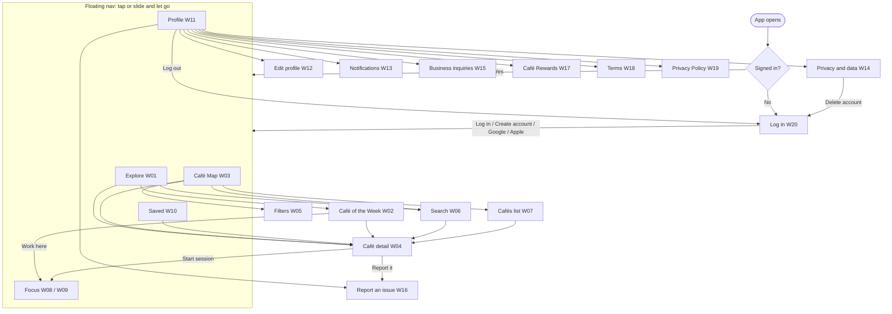

# Work & Brew — App Flow

Every screen, how people get to it, what they can do there, and where it leads. Routes are the real file paths in `src/app/`. The screen numbers (W01–W20) match the Spotlight wireframe kit.
Status: **Built** · **Local** (works on sample data; needs the Supabase connection) · **Gap** (in the PRD, not built yet). Details are in [TRD.md](TRD.md).

---

## 1. Big picture

## 2. Entry and sign-in

| Step | What happens | Status |
| --- | --- | --- |
| App opens | Fonts load, then the saved session is checked. A blank dark screen shows while loading (no flash of the wrong screen). | Built |
| `/` (`src/app/index.js`) | Sends signed-in people to `/explore`, everyone else to `/login` | Built |
| Protected routes | Every tab screen is behind a guard (`Stack.Protected` in `src/app/_layout.js`). Signed-out people can only reach `/login`. | Built |
| **W20 Log in** (`/login`) | Navy screen: logo, "Vetted cafés for getting work done in NYC.", **Log in**, **Create an account** | Built (local sign-in) |
| Log in → email + password form → tabs | | **Gap** (AUTH-1) |
| Create account → name, email, password → "Check your email" → confirm link → tabs | Sign-ups need Confirm email on | **Gap** (AUTH-1) |
| Forgot password → email → reset link → new password | | **Gap** (AUTH-2) |
| Continue with Google / Continue with Apple → system sign-in sheet → tabs | Apple is needed on iOS if Google ships | **Gap** (AUTH-3, AUTH-4) |
| Errors to show | Wrong password · email not confirmed · sign-ups closed · no connection | **Gap** |

## 3. Navigation bar (all tab screens)

- Floating pill bar: **Explore · Map · Focus · Saved · Profile**. The active tab grows into a cream pill. (Nav design review: concept #9, David's top pick, with tap added.)
- **Tap** a tab to go there. **Press and slide** along the bar: the tab under your finger highlights, and letting go opens it.
- Tapping the tab you're already on returns to that tab's first screen.
- Each tab keeps its own history. Leaving Map on a café and coming back shows the same café.

## 4. Explore tab

### W01 Explore / Home (`/explore`)
Design: "Card Wallet" (Home design review: David's #1) with the Spotlight hero.

| Element | Action | Goes to | Status |
| --- | --- | --- | --- |
| Hero: Café of the Week photo, name, highlights, rating | — | — | Local |
| Search icon | Tap | W06 Search | Built |
| Avatar (your photo or initial) | Tap | W11 Profile | Built |
| **Read feature** | Tap | W02 Café of the Week | Built |
| **My list** / **On my list** | Tap toggles save | stays (Saved updates) | Local |
| Wallet: Last visited · Nearby right now · Your week | Tap a back card → it moves to the front. Tap the front card → opens it. | Café detail / Focus | Local |
| **Begin session** | Tap | Focus tab | Built |
| **Café map** | Tap | Map tab | Built |
| Top 4 near you today (big outlined numbers) | Tap a poster | W04 Café detail | Local |
| Because you saved {café} (hidden when nothing is saved) | Tap | W04 Café detail | Local |
| Community Favorites by borough | — | — | **Gap** (DIS-8) |

### W02 Café of the Week (`/explore/feature`)
Header photo, "Café of the week" label, name, headline, byline, The space, pull quote, Working here (4 amenity tiles), What to order and its photo.
- **See on map** → W04 Café detail.
- **Work here** → starts the timer at this café → Focus tab.
- **Back** → W01.

## 5. Map tab

### W03 Café Map (`/map`)
| Element | Action | Result | Status |
| --- | --- | --- | --- |
| Search bar | Tap | W06 Search | Built |
| **Filters** (badge shows how many are on) | Tap | W05 Filters | Built |
| Neighborhood chips | Tap toggles | Map and count show that neighborhood only | Local |
| Borough filter | — | — | **Gap** (DIS-2) |
| Quick filters: Quiet, Outlets, Open late, Hot food, Big tables | Tap toggles | Pins and count update; saved to settings | Local (chip list under review: TRD Open question 3) |
| Pin | Tap | Selects it and shows a pop-up card; tap the card → W04 | Built (stand-in map) |
| "{n} cafés in {area}" pill | Tap | W07 Cafés list | Built |
| Locate button | Tap | Explains that live location is coming, or that location is off | Built (placeholder) |
| Real map with Iris's custom pins | — | — | **Gap** (DIS-1) |

### W04 Café detail (`/map/cafe/[id]`)
Bottom sheet over the map: name, type, neighborhood · borough · distance, chips (Open until, Scout verified, rating), photo gallery, actions, amenity grid, "Why our scouts picked it".
- **Directions** → Apple Maps (iOS) or Google Maps (Android/web), searching by name and address.
- **Start session** → starts the timer at this café → Focus tab.
- **Bookmark** → save or unsave (navy when saved).
- **Close (X)** or tapping the map above the sheet → back.
- **Something wrong? Report it** → W16 with the café name filled in.
- Missing: hours per day, website, menu link, Small Biz badge, "(?)" explainers (**Gap**: DIS-3, DIS-4).
- Unknown café id → "Café not found".

### W05 Filters (`/map/filters`)
Sheet with **Work · Vibe · Rules · Food** tabs (tapping one scrolls to that section), selectable pills, **Reset**, and a sticky **Show {n} cafés** button that goes back to the map.

### W06 Search (`/map/search`)
The keyboard opens automatically. Results update as you type (name, neighborhood or borough). Tap a result → W04. No matches → "No cafés match …".

### W07 Cafés list (`/map/list`)
"{n} cafés in {area}" plus a note of how many filters are on; tap a row → W04.

## 6. Focus tab (`/focus`)

The timer state is shared app-wide: it keeps running while you browse other tabs.

### W08 Focus (collapsed)
| Element | Action | Result | Status |
| --- | --- | --- | --- |
| Kicker: "Session {n} of 4 · at {café}" | — | — | Built |
| Timer card (navy; green on break) | Tap the card | Expands to W09 | Built |
| Play / pause button | Tap | Starts or pauses | Built |
| Brain dump bar | Type + **Save** or return | Adds a to-do (Do first) | Local |
| Do first / Schedule / Delegate / Drop counts | — | Open tasks per quadrant | Local |
| To-do row | Tap | Check / uncheck | Local |
| Priority dot | Tap | Cycles Do first → Schedule → Delegate → Drop | Local |
| To-do row | Long press | Confirm, then delete | Local |
| "Now" badge | — | On the first open task while focusing | Built |
| Category tags (Work, Classwork, Homework, Start Up, Project) | — | — | **Gap** (PRO-4) |
| Interactive 2×2 Eisenhower Matrix | — | — | **Gap** (PRO-5) |

### W09 Focus timer expanded
Session dots, large clock, progress bar, current task, **Pause/Start**, **Reset**, "Hold the clock to skip to your break", brain dump, and **Up next** (open tasks after the current one). The **collapse** button returns to W08.

### Timer rules
- Focus 25 min → **logs the session** (to the café if one was chosen) → 5 min break starts automatically → next session waits for **Start**. After session 4 it loops back to 1.
- Holding the clock skips ahead. Skipping a focus session logs only the minutes actually focused (nothing if under 1 minute).
- **Reset** restarts the current phase.
- Restarting the app resets the timer (**Gap**: PRO-6 Pick up where you left off).

## 7. Saved tab

### W10 Saved (`/saved`)
**All · Deep focus · Weekends** tabs, café rows (tap → W04, **X** → unsave), and the "Something new is brewing" card (**Notify me** ↔ **You're in**). Empty states: "No saved cafés yet. Tap the bookmark on any café." / "Nothing in this list yet."
- Choosing which list a café goes into when saving: **Gap** (new saves go to All only).

## 8. Profile tab

### W11 Profile (`/profile`)
Member card (photo, name, borough, member since, member number), stats (sessions · cafés visited · average session), About you (**Edit** → W12), Café Rewards → W17, the Settings rows below, **Log out** (asks to confirm → W20), and **Terms** / **Privacy Policy** links.

| Row | Goes to | Status |
| --- | --- | --- |
| Edit profile | W12 | Local |
| Notifications | W13 | Local |
| Privacy and data | W14 | Local |
| Business inquiries ("For café owners") | W15 | Local |
| Report an issue ("App issues") | W16 | Local |
| Notify our café scouts (suggest a café) | — | **Gap** (ACC-4) |

### W12 Edit profile (`/profile/edit`)
Photo (**Add / Change photo** → photo library, square crop), Name (required), About (150-character limit with counter), "I go to cafés to" pills, School (optional), Borough (picker sheet), "What you need most" pills, **Save changes** → back to W11.

### W13 Notifications (`/profile/notifications`)
Toggles: Push notifications, Email, Weekly digest, New cafés near me. Saved right away.

### W14 Privacy and data (`/profile/privacy`)
Toggles: Location while using the app, Share stats with friends, Personalized picks.
- **Download my data** → confirmation message (real export: **Gap**, ACC-5).
- **Delete my account** → confirm → account and all its data deleted → W20. Team accounts are refused, since the hub manages them.

### W15 Business inquiries (`/profile/business`)
Name, Email (format checked), Topic picker (List my café · Partnership · Press · Other), Message → **Send message** → "Message sent" screen (**Back to profile** / **Send another**). A missing field shows "A few details missing".

### W16 Report an issue (`/profile/report`)
What's wrong (Wrong café info · App bug · Café closed · Other), Café (optional, suggests matches as you type, pre-filled when opened from a café), Details (required) → **Send report** → "Report sent".

### W17 Café Rewards (`/profile/rewards`)
"Coming soon" card → **Notify me at launch** ↔ **You're on the list**.

### W18 Terms / W19 Privacy Policy (`/profile/terms`, `/profile/privacy-policy`)
Placeholder text (**Gap**: ACC-6, required before store submission).

## 9. Cross-cutting behavior

| Topic | Behavior |
| --- | --- |
| Back | Every pushed screen has a round back button; Android's back gesture works the same way |
| Confirmations | Log out, delete account and delete task all ask first (native alert on phones, browser dialog on web) |
| Loading / empty / errors | Required on every network screen once Supabase is connected (TRD NFR-6) |
| Layout | Phones use full width; iPads center content (max 680 pt); landscape supported |
| Safe areas | Content clears the notch / Dynamic Island and the home indicator; the nav floats above the home indicator |
